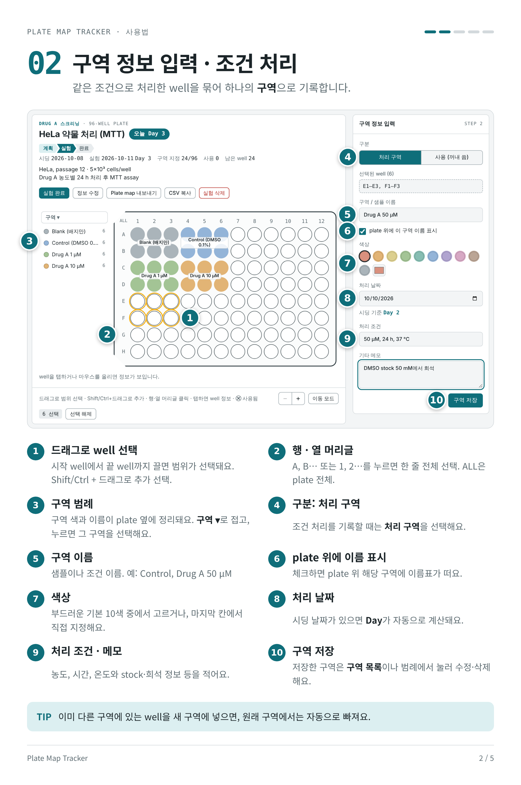
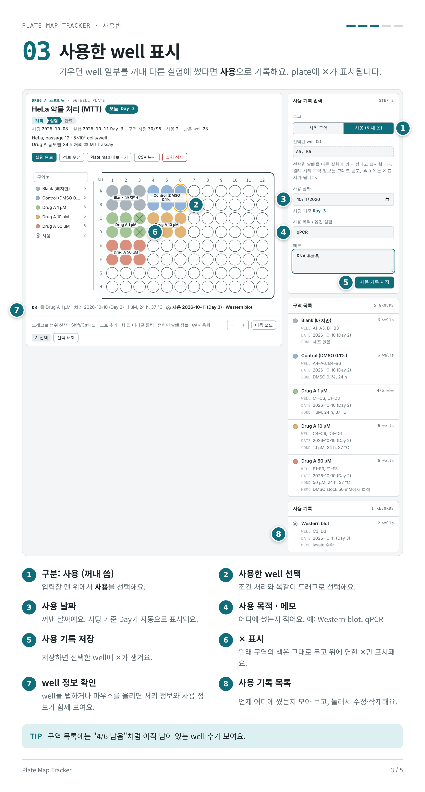
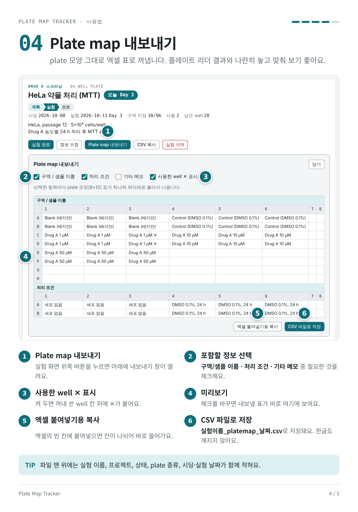
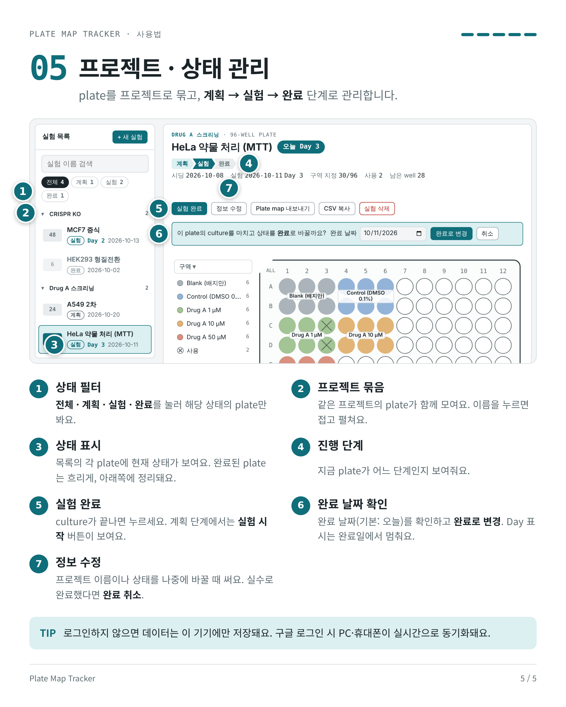
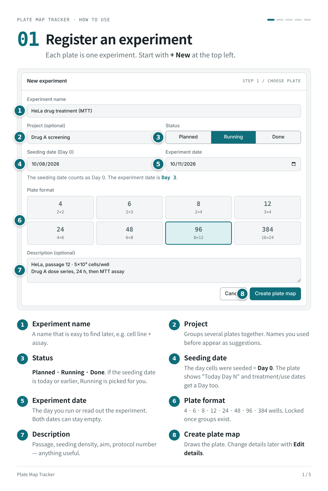
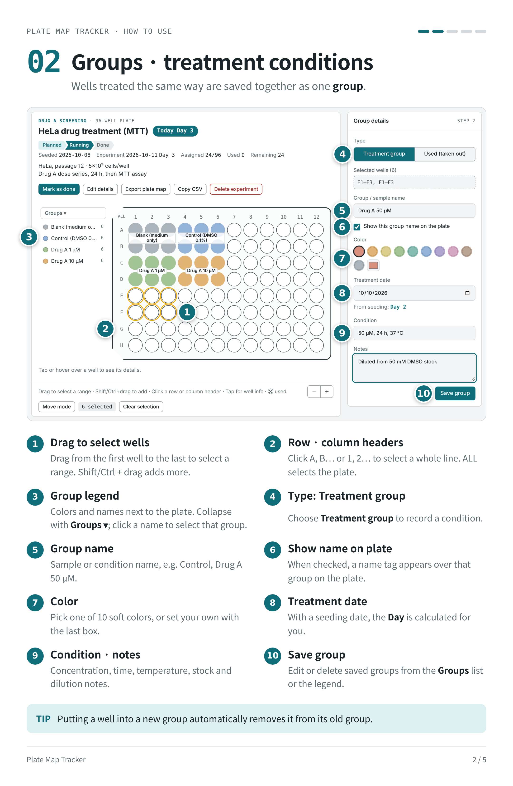
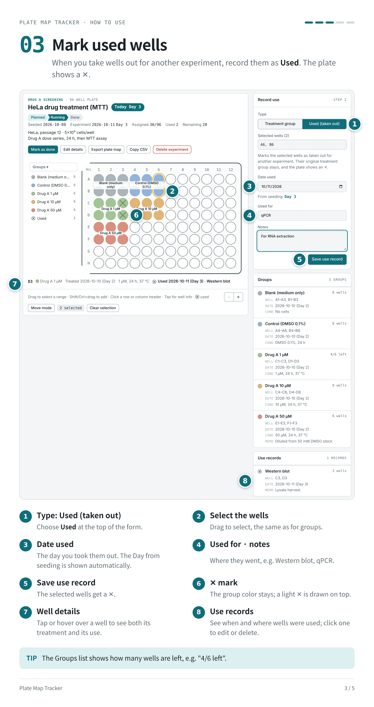
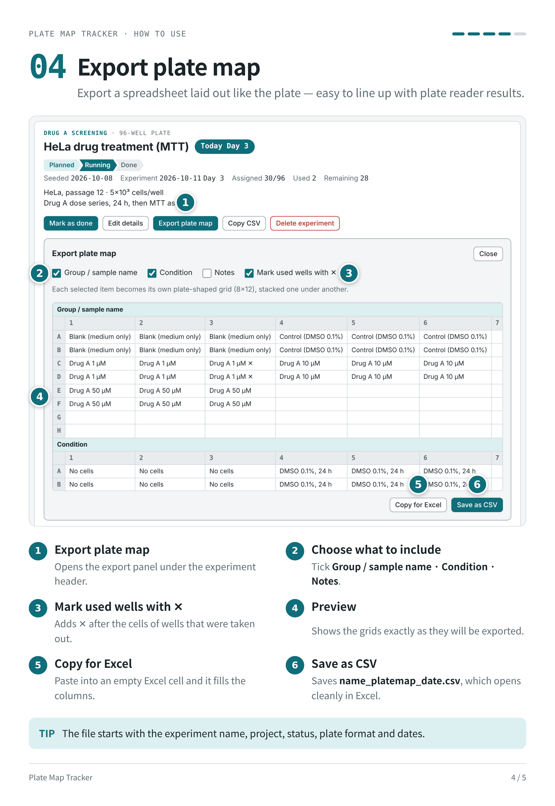
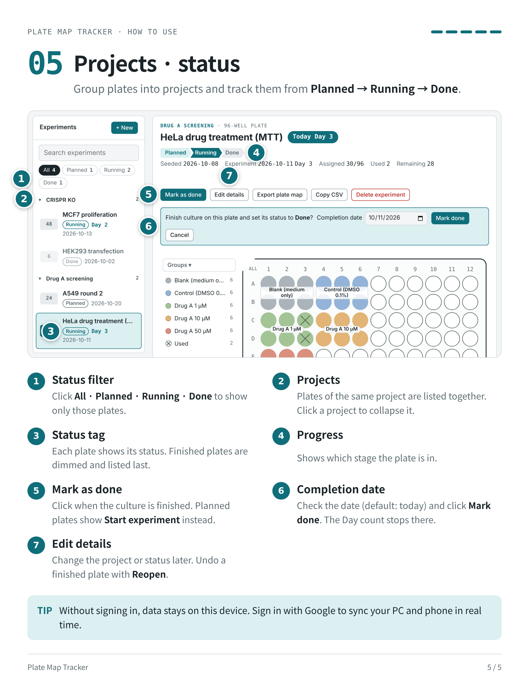

# Plate Map Tracker

**한국어** | [English](#english)

Well plate(4–384 well)의 샘플 위치, 처리 조건, 사용 기록을 관리하는 웹앱입니다.

- 한국어: https://jeeyoung-code.github.io/Plate-map-tracker/ko/
- English: https://jeeyoung-code.github.io/Plate-map-tracker/en/

### 주요 기능
- 실험(plate) 등록: 프로젝트, 상태, 시딩 날짜(Day 0), 실험 날짜, plate 종류
- 드래그로 well 구역 지정, 색상·처리 조건·메모 기록, plate 위 구역 이름 표시
- 꺼내 쓴 well은 "사용"으로 ✕ 표시
- 상태 관리: 계획 → 실험 → 완료
- Plate map 내보내기 (CSV)
- 구글 로그인 시 PC·휴대폰 실시간 동기화

### 데이터
- 로그인하지 않으면 데이터는 사용하는 기기에만 저장됩니다.
- 구글 로그인 시 본인 계정에만 저장되며, 다른 사람은 볼 수 없습니다.

### 사용법

---

## English

[한국어](#plate-map-tracker) | **English**

A web app for tracking sample positions, treatments and used wells on 4–384 well plates.

- Korean: https://jeeyoung-code.github.io/Plate-map-tracker/ko/
- English: https://jeeyoung-code.github.io/Plate-map-tracker/en/
- 

### Features
- Register experiments (plates): project, status, seeding date (Day 0), experiment date, plate format
- Drag to select wells into groups; record color, condition and notes; show group names on the plate
- Mark wells taken out for other experiments as "Used" (shown with ✕)
- Track status: Planned → Running → Done
- Export the plate map as CSV
- Sign in with Google to sync in real time between PC and phone

### Data
- Without signing in, data is stored only on the device you use.
- With Google sign-in, data is stored in your own account and no one else can see it.

### How to use

